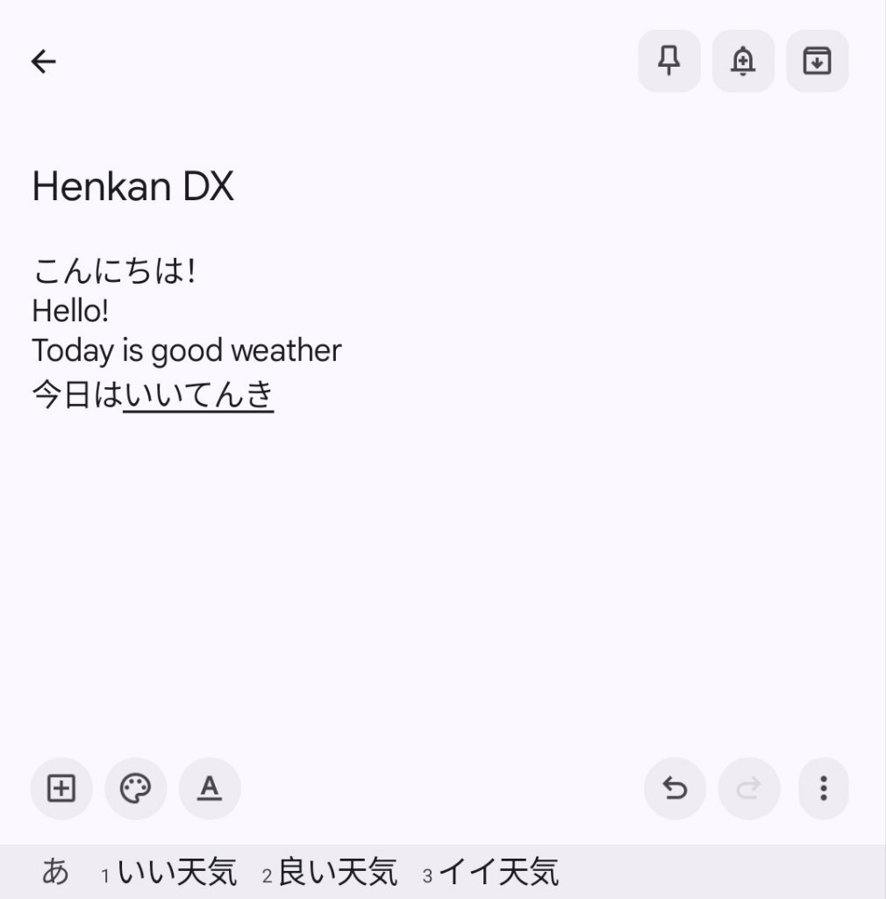
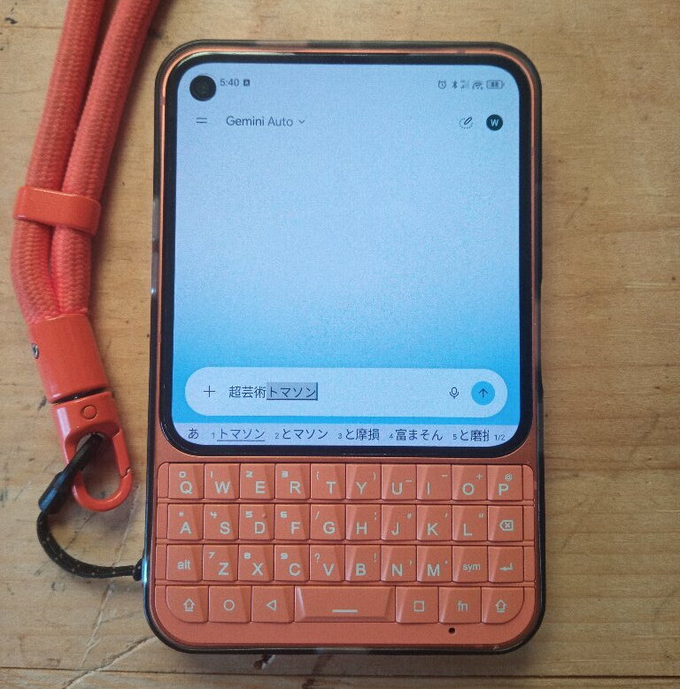

# Henkan DX (変換DX)

Japanese input for physical keyboards on Android phones

<p align="center">
  
  
</p>

Status
------

I use a Unihertz Titan Elite 2 and have access to a Titan Pocket so support for
these phones is first-class. Everything else is best-effort. Software is
pre-release.

## Installing

1. Download and install the [latest
   release](https://github.com/wesl-ee/henkan-dx/releases) (Android 8.0 or
   newer)
2. Open Henkan DX, tap Open Keyboard Settings and enable Henkan DX
3. Install language packs in the app

## Keys

Input is romaji-based, ALT will input the secondary symbol printed on the key.
Other symbols are accessible with the "Sym" key.

| Key                 | Action                                   |
|---------------------|------------------------------------------|
| Space               | Pick a suggestion, or convert and cycle  |
| ⇧+Space             | Convert clause by clause                 |
| Enter               | Commit                                   |
| alt+1–9, or tap bar | Pick a candidate                         |
| fn+E/S/D/F          | Arrow keys                               |
| fn+S/F              | Previous/next clause, while converting   |
| ⇧+S/F               | Shorten/lengthen clause                  |
| fn+Q                | Cancel conversion                        |
| fn+B                | Add word to user dictionary              |
| Sym                 | Symbol page                              |

⇧, alt and fn are sticky: tap once for the next key and twice to lock.

### Titan 2

- Right ⇧ switches between あ and A

### Titan Pocket

- fn+Space switches between あ and A

### Other keyboards

- Ctrl+Space switches between あ and A
- There are no fn shortcuts yet. Use the arrow keys if your keyboard has them

## Privacy

- Zero android permissions and zero network access
- Switches to direct input in password and other sensitive inputs
- Does not back up or transfer learning data.
- Learned words can be erased any time

## Tech

- Japanese conversion is Mozc
- Mozc runs with its desktop MS-IME style keymap
- Kotlin with plain Android Views and no AndroidX

## Building

Mozc is a git submodule so fetch it after cloning.

```sh
git submodule update --init --depth 1
```

with Nix, nix build produces unsigned release APKs in result/.

```sh
nix build
```

nix develop opens a shell with the JDK and the Android SDK.

```sh
nix develop
```

Without Nix, engine/mozc/build.sh builds libmozc.so and mozc.data (it needs bazelisk, Python 3 and a C++ compiler) and then Gradle builds the APK

```sh
engine/mozc/build.sh
./gradlew assembleDebug
```

On NixOS run the Mozc build script inside the dev shell's FHS environment

```sh
nix develop -c fhs -c engine/mozc/build.sh
```

## License

MIT License (available in the source tree as /LICENSE)

Mozc is BSD-3-Clause licensed (see NOTICE)
